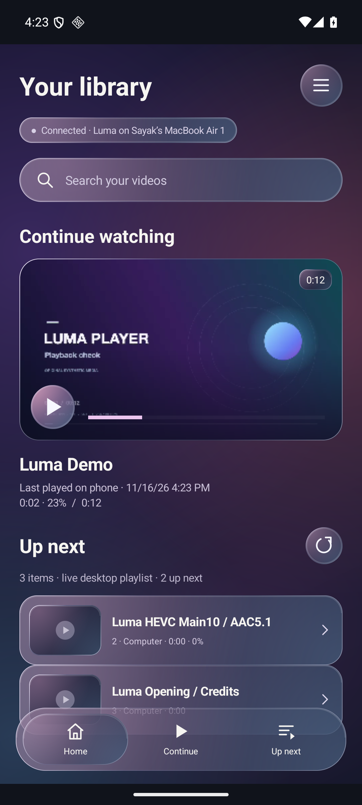
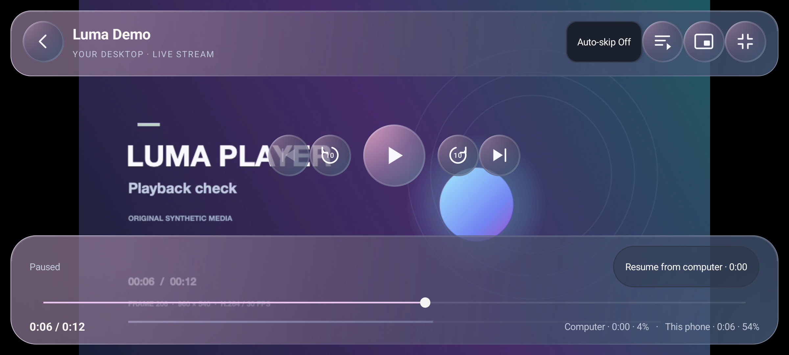
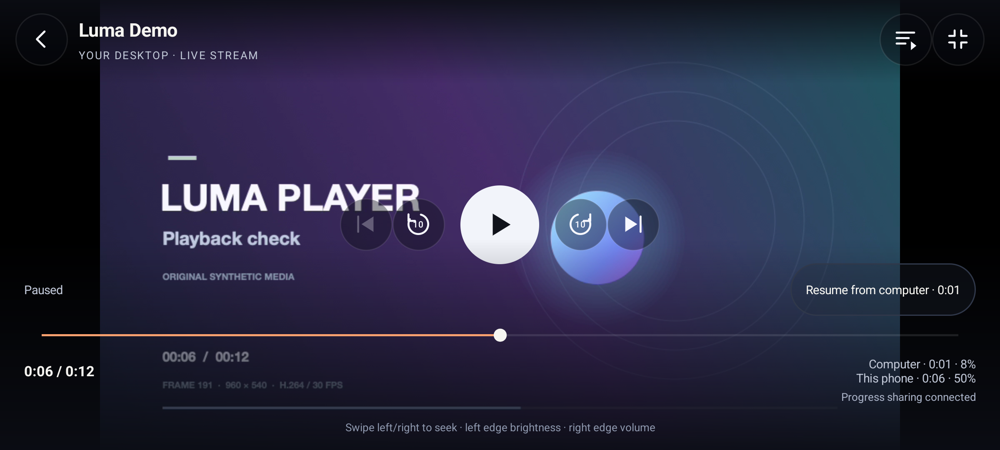
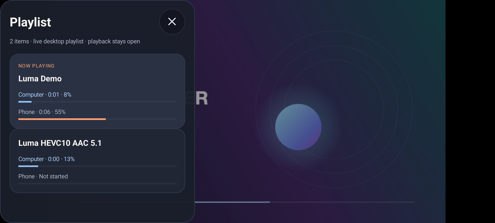

# Luma for Android — local streaming preview

Native Android companion by **sdas**. Pair with Luma on your desktop over the same trusted Wi-Fi, browse its live playlist, and stream media without saving a phone download. Playback uses VideoLAN libVLC; it does not recreate its codecs or guarantee every VLC format on every Android device.

The [public ARM64 preview APK](https://github.com/PopoD-alt/luma-player/releases/download/v0.7.0-preview.1/Luma-0.7.0-Android-arm64-preview.apk) is the owner-tested **0.1.0-preview companion** distributed with desktop 0.7.0. It uses the reviewed, source-built component `android-lgpl-arm64-3.7.7-r2`. Download its [matching source/license companion](https://github.com/PopoD-alt/luma-player/releases/download/v0.7.0-preview.1/Luma-0.7.0-Android-arm64-source-and-notices.zip) for complete app/native sources, notices and replacement instructions. The APK remains debug-signed; production signing, Play Store distribution and automatic updates are not configured. See [INSTALL.md](../INSTALL.md#android).

The default Maven AAR remains **development-only**: its native/Java payload includes GPL components and is not the public APK's runtime. An explicit build selector chooses the reviewed ARM64 component. Its exact library/module/dependency/source/replacement audit is recorded in [ThirdParty/libvlc](../ThirdParty/libvlc/README.md). Technical component checks and the owner's successful test do not establish legal/patent clearance or every device/format combination.

## Glass UI, handoff and picture-in-picture review

Current source on `main`: **0.4.0-preview / version code 4**, paired with desktop **0.10.0**, updated **2026-11-16**. These versions remain source and local review builds; the public APK remains 0.1.0. Its application ID and existing debug signing certificate are retained for in-place review updates.

The home screen puts **Continue Watching / Now Playing** first and follows it with **Up Next** in desktop playlist order. Earlier entries remain accessible after the upcoming queue. Open the **hamburger menu** for discovery, pairing, local address entry and disconnect. The violet/rose glass interface follows the supplied UI references. Poster images are real playback frames, held in a private bounded thumbnail cache (up to 24 small images / 4 MB); no full video is saved.

- Double-tap the **right half** for **+10 seconds**, or the **left half** for **−10 seconds**. Jumps clamp to the video bounds. A single tap shows/hides controls after the double-tap window. Holds, swipes, cancelled contacts and opposite-half taps are not combined as seek gestures.
- Tap the **picture-in-picture icon** for a floating video on devices that support PiP. Home automatically enters PiP while a video is playing. Long-press that icon to change the Home preference. The OS supplies Pause/Play and Close controls. Closing PiP, or leaving with PiP disabled, releases playback and its network stream. Expanding restores the prior fullscreen and pause state.
- Opening an item uses the newest timestamped computer/phone checkpoint from the host. Normal Play on a paused video can accept newer computer progress. A deliberate seek while paused takes priority on the next Play. Reports never move a video that is already playing. Completed items restart from the beginning.
- Cold launch displays last-played details without autoplay. Connect to the desktop to refresh the cross-device state; cached details alone cannot start a stream. Progress may lag by several seconds, and Wi-Fi loss can prevent a final checkpoint arriving.





Validation: **84 JVM tests and lint** pass. The exact same APK passes all **five native cases against each production desktop server**: baseline AVC/HEVC playback, auto-skip, real double-tap MotionEvents, actual OS PiP Home/Pause/Close/expand, and home/checkpoint/cache behavior. Fullscreen transport is checked to stay clear of the header/footer. The owned ARM64 emulator uses manual local addresses; physical Wi-Fi discovery, phone audio interruptions and hardware remain owner review.

PiP uses the same native player, video surface and authenticated stream; it is not a background download. Android controls device PiP availability and permission. Videos remain on the computer, which must stay awake with sharing enabled. This build does not add invisible background audio playback or a media download library.

## Auto-skip preview

Auto-skip was introduced in **0.3.0-preview / version code 3** and is included in the current **0.4.0-preview** source on `main`. The public APK above is still 0.1.0. The new review APK retains the public preview's application ID and signing certificate for in-place updates.

Tap **Auto-skip Off** in the video header to open its settings, then enable **Auto-skip openings and credits**. It starts off and is a separate preference on each device. Recognised named chapters or saved ranges drive the jumps; a **Skip intro / Skip credits** button appears when a range is active. Explicit rewind/seek lets you replay that section, and enabling auto-skip while paused keeps playback paused.

If there are no useful chapter labels, pause/seek to the desired start and choose **Mark opening start here** or **Mark credits start here**. Move to its end and mark the end. Ranges must fit within the video without overlapping. The phone saves its override locally; **Use desktop timings** restores the current shared desktop configuration. Clearing saved phone timings does not disable recognised native chapters; use the Auto-skip switch to turn automatic skipping off.

A desktop running 0.9.0 or later shares its saved ranges as optional read-only playlist metadata. Audio matches confirmed on the desktop become saved ranges; Android does not run the episode-comparison job itself. Old hosts can keep streaming, with local chapter/manual skipping available where native timing and seeking are supported.

Recognised labels include Intro/Opening/OP and Credits/Outro/Ending/ED plus supported simple variants. Numbered generic chapters, recaps and post-credit labels are ignored. Skipping to a chapter's end preserves a separately marked post-credit scene, but cannot detect a hidden scene inside the credits chapter. Automatic analysis is repeated-audio matching with confirmation on desktop, not an AI classifier or universal recognition of arbitrary video.

## Modern player review

The controls below were introduced in **0.2.0-preview / version code 2** and remain included in the current **0.4.0-preview / version code 4** source on `main`. The public 0.1.0-preview link above remains the earlier app. New review builds preserve its application ID and debug signing certificate so a normal update can retain app data. This is a local owner-review build, not a Play Store or production-signed release.

- **Tap video:** show/hide controls; they fade while playing and remain available while paused.
- **Center icon:** play/pause. Adjacent icons jump ten seconds or open the previous/next playlist item. Previous/next is disabled at the queue ends.
- **Horizontal swipe:** preview the destination and seek on release. A cancelled swipe does not seek. The seek bar is also available.
- **Vertical swipe on right:** change libVLC player volume from 0–100%. **Vertical swipe on left:** change this playback window's brightness. The indicator is normally hidden and fades after the gesture. Leaving playback restores the window brightness setting; no permission to change global brightness is used.
- **Playlist icon:** show a left drawer over the video. Playback continues; close the drawer or tap another item without leaving the playback screen.
- **Fullscreen icon / Back:** enter/leave fullscreen. Back first closes an open drawer. Android system edge gestures still belong to the OS.

In the 0.4.0 source, opening an item uses the latest saved phone/computer position; a completed checkpoint restarts from the beginning. The playlist drawer and playback footer distinguish **Computer** from **This phone**, with time, percentage and completion state. Desktop queue/details views show the same two saved positions and the phone's last update time. Use **Resume from computer** on the phone or **Resume from phone** on desktop to jump deliberately; a received report never interrupts the other player's position.

Progress sharing needs desktop 0.8.0 as well as Android 0.2.0. Reports are authenticated, sent in the background about every five seconds while playing, and coalesced after pause, seek or leaving playback. The host persists the latest phone checkpoint alongside its local library. Progress can lag by a few seconds, and closing the process or losing Wi-Fi can prevent the final checkpoint arriving. Multiple paired phones share one Phone checkpoint per video. With an older host, streaming remains available and the app clearly shows that phone progress sharing is unavailable. No cloud account or media upload is involved. The final original-key APK also passes a public version-code-1 → review version-code-2 in-place upgrade followed by the full native UI/progress test (33.874s), without clearing app data between versions.





## Use

1. Enable local playlist sharing in Luma on your desktop. Keep that computer awake and allow its local sharing port through the private-network firewall.
2. Connect the phone to the same trusted Wi-Fi. Allow local-network access when Android requests it.
3. In Android 0.4.0, open the **hamburger menu**, then choose a nearby desktop or enter the desktop's displayed `http://IP-address:port`.
4. Enter the current six-digit code from the desktop. Select an item from its live playlist.
5. Use the playback controls or gestures described above. The public 0.1.0 APK still uses the older text buttons and separate playlist screen; install the review build to try the new controls and drawer.

Playback waits for a visible, sized video view. Hardware decoding stays enabled on compatible devices; if a known video with received stream bytes never creates output, the app makes one automatic software retry and remembers that choice for the item during the current connection. Audio-only playback and reported network errors do not trigger this retry. Bookmark seeking waits for native Playing and the first video output rather than interrupting decoder initialization. A newer Play action keeps its intent when an older native Paused event arrives.

The phone refreshes the playlist every five seconds while visible, including PiP. When the host bounds a large playlist, it clearly shows “Showing first N of M items” above the list. Protocol limits are 1000 returned items, 512 UTF-16 units per title, one year per duration/resume value, and 4 MiB per JSON response. The review app shows separate desktop/phone positions and reports phone progress to compatible hosts. It also keeps a session-local position while a checkpoint is in flight. Visible PiP keeps the stream running. Closing PiP, or leaving with PiP disabled, releases network playback; returning shows Continue Watching without autoplay. Pausing stops playback while bounded stream buffers may fill. Re-pair after desktop sharing restarts. The desktop URL is the only saved connection preference. Pairing tokens remain in memory and are scoped to that desktop's current sharing session.

Local sharing uses **unencrypted HTTP**. Use a home network you trust. Manual addresses must be numeric private/link-local/loopback IP addresses with an explicit port; public hosts, DNS names, credentials, cloud URLs, cross-origin stream links and redirects are rejected. Native libVLC receives a nonce-protected loopback URL; the desktop token stays in the bounded HTTP relay. The relay uses a 64 KiB transfer buffer, forwards GET/HEAD and single byte ranges, and writes no media files. No cloud service, analytics, upload, or remote desktop controls are implemented. Play trusted media from your own desktop.

## Build

Requires **JDK17**, the Android SDK, `platforms;android-37.0`, `build-tools;36.0.0`, and platform-tools. Set `ANDROID_HOME` or use an untracked `local.properties` with `sdk.dir`.

```sh
cd Android
./gradlew --no-daemon assembleDebug assembleDebugAndroidTest testDebugUnitTest lintDebug
adb install -r app/build/outputs/apk/debug/app-debug.apk
```

The Gradle9.6.0 wrapper verifies the official distribution SHA256. AGP9.4.0 and all direct dependencies have pinned versions. `gradle/verification-metadata.xml` pins resolved dependency checksums, including the candidate AAR. Build tools and downloads under `.tools/` are local-only and excluded from git.

- Main development APK: `app/build/outputs/apk/debug/app-debug.apk`
- Test APK: `app/build/outputs/apk/androidTest/debug/app-debug-androidTest.apk`
- Debug application ID: `dev.sdas.luma.preview`
- Android8/API26 minimum; compile/target API37. Default development ABIs: arm64-v8a, armeabi-v7a, x86_64. The reviewed custom runtime currently supports ARM64 only.
- For an in-place update, use the same signing keystore as the installed preview and compare the APK certificate fingerprint before delivery. Set `ANDROID_USER_HOME` consistently when using the project-local debug keystore; a successful rebuild can otherwise select or generate a different debug key. Never commit a keystore or its passwords.
- Debug signing is for testing only. The stock and arbitrary local-AAR paths fail the release gate. The approved selector verifies all four central audit flags, the complete staged inventory/source bundle/notices, and the exact AAR SHA256 before any build uses it.

For private review with an already staged, approved component:

```sh
./gradlew --no-daemon -PlumaRuntimePackage=android-lgpl-arm64-3.7.7-r2 \
  verifyReleaseRuntimeAudit assembleDebug assembleDebugAndroidTest testDebugUnitTest lintDebug
```

This checks the release audit task but produces **debug APKs only**, under `app/build-approved-runtime/outputs/apk/`. Native library hashes are preserved; complete staged native notices and Java runtime notices are included in APK assets. Every distributed APK must also be accompanied by `Sources/CorrespondingSource.tar` from the immutable staged library package **and the matching application source/object inputs** for Java-wrapper relinking. The component source bundle carries its review-time application reference; later UI changes require their own matching application snapshot.

`-PlumaDevelopmentAar=/absolute/path/to/library.aar` remains available for personal rebuilding/relinking tests, with separate outputs under `app/build-custom-native/`; this arbitrary local path always blocks release packaging. Do not combine it with `lumaRuntimePackage`. Gradle may remove stale APK outputs when switching runtime choices; copy private review evidence outside these generated directories before another build. [Android/scripts](scripts/README.md) documents the pinned NDK source build, excluded GPL implementations, Java-source AAR build and independent debug signing/replacement helper. The default stock AAR is never silently substituted into a selected reviewed build.

On Android17/API37 the app requests `ACCESS_LOCAL_NETWORK`. Android16/API36 uses `NEARBY_WIFI_DEVICES` for the applicable local-network protection flow. Earlier versions need the manifest network permissions; no location access is requested. Discovery uses `_luma-player._tcp.` with a manual connection fallback. Routers that isolate Wi-Fi clients or suppress multicast can prevent discovery or streaming.

## Validation

`testDebugUnitTest` exercises private-address restrictions, same-origin/session-scoped stream URLs, actual HTTP pairing/Bearer playlist requests, malformed metadata, redirect denial, GET/HEAD/range forwarding and token-hiding relay URLs. `lintDebug` checks Android API usage and app resources. New tests cover typed optional progress metadata, authenticated bounded progress POSTs, older-host compatibility, rate-limit/authorization behavior, coalescing, backward seeks and gesture clamping. The approved runtime build passes all 52 JVM tests and lint.

The instrumentation test uses the **production desktop sharing server**, not a simulated playlist or fake decoder. Start its synthetic fixture host with stdin kept open:

```sh
dotnet Windows/Luma.Core.Tests/bin/Debug/net10.0/Luma.Core.Tests.dll \
  --sharing-test-host FIXTURES_DIRECTORY READY_JSON_PATH
```

Read its ready JSON (`port`, `code`, `ids.demo`, `ids.hevc10`) without printing credentials. Install both APKs, then substitute those values:

```sh
adb install -r app/build/outputs/apk/androidTest/debug/app-debug-androidTest.apk
adb shell am instrument -w \
  -e serverUrl http://10.0.2.2:PORT -e pairCode CODE \
  -e demoId DEMO_ID -e hevcId HEVC_ID \
  dev.sdas.luma.preview.test/androidx.test.runner.AndroidJUnitRunner
```

API36 `google_apis` x86_64 is suitable for the stock development CI path; use ARM64 for the reviewed runtime. API35 is also supported and needs no runtime local-network permission. The test pairs through the actual dialog, loads the live playlist, streams AVC and synthetic HEVC Main10/AAC5.1, and asserts native decoded video/audio plus displayed-frame counters. It also checks Opening pause intent, rapid Pause→Play, native pause, byte-range seek, volume, and fullscreen with hidden chrome/settled system bars while retaining the same player/view and advancing displayed frames. An optional explicit fault argument exercises the one-time software recovery. Status output includes libVLC version/changeset, decoder counters and video-view/output readiness without URLs or tokens. Review PNGs are captured before the activity closes at app-private `cache/luma-android-review.png`, `cache/luma-android-fullscreen.png`, `cache/luma-android-modern-controls.png` and `cache/luma-android-playlist.png`; the harness can pull them with `adb exec-out run-as dev.sdas.luma.preview cat cache/FILENAME`. It checks app files/cache for saved media downloads. The test acknowledges only Android's standard first-use fullscreen tutorial if present; application permissions/settings are unchanged.

The modern-player ARM64 native checks pass against both production server implementations: Mac **33.311s**, portable Windows-Core **25.389s**. They exercise icon controls, previous/next, cancelled and committed swipe seeking, hidden volume/brightness indicators, an overlay drawer on the same advancing native player, and explicit resume during native startup. An independent authenticated playlist read matches the actual phone report while the computer position remains unchanged; explicit Resume from computer then advances the real native clock and displayed frames. These checks do not represent a physical Windows/Android Wi-Fi test.

The root [integration harness](../Scripts/run-android-integration.py) now runs five native cases against separate fresh production sharing hosts, avoiding shared-state and pairing-limit interference. `--test-method` selects an isolated case. It supports the actual portable Windows-Core server or native Mac server, custom app/test APK paths, separate report directories, and `--exercise-video-recovery`. Optional `--stress-transitions` exercises ten alternating AVC/HEVC opens within the same paired session, network, activity and native engine, with real native clock/frame progress after seeking and AVC fullscreen transitions. Local ARM64 source-built runtime runs have passed both desktop servers, normal startup, explicit recovery, independent APK re-signing and this bounded transition check. These are fixture checks rather than full VLC parity.

The 0.4.0 approved-runtime debug source passes **84 JVM tests and lint**. The earlier 0.3.0 source also passed the default development build; that build is not the review distribution. First playback prepares the native font cache on a background worker before creating any decoder or renderer; the UI remains responsive. A true-cold, quiet ARM64 run of the approved runtime passed preparation and the full playback checks. Preparation completion and persistent cache validation are reported separately; a failed cache-validation flag does not trigger repeated native scans.

MP4 and QuickTime MIME families (`video/mp4`, `audio/mp4`, `video/quicktime`) use the retained native avformat demuxer. A same-library comparison reproduced a short HTTP MP4 whose default demuxer left native time at 250 ms while frames advanced; avformat passed actual native-clock progression and precise seeking. Other container families retain automatic demuxer selection. The instrumentation waits for the desktop bookmark to settle and for the real native clock and displayed frames to advance before checking rapid Pause→Play.

Actual ARM64 instrumentation also destroys and recreates a `SurfaceView`, pauses during repair, then verifies preserved intent, restored native playback position, and advancing displayed frames on the same player/view. Startup requires the native surface-created callback and a valid holder; each new player gets fresh views, while old stop/disconnect work runs off the UI thread. [Earlier quiet x86_64 CI for the MP4 timing policy passed](https://github.com/PopoD-alt/luma-player/actions/runs/43767190446). Current ARM64 route-repair proofs pass against both production servers, including independent re-signing and ten same-session transitions. Current x64 CI has the Wi-Fi limitation below; physical phones and discovery remain separate review.

Earlier fresh x86_64 emulator failures were traced to an OS-removed Wi-Fi `Network` retained by the app: TCP connect returned `EPERM`, while the desktop remained healthy and no request reached a decoder. API requests and streams now share a session-scoped Wi-Fi connection provider. It uses currently listed Wi-Fi routes, excludes cellular/VPN/default fallback, and pins the desktop ID before showing pairing. A replacement route must return matching public `/v1/info` at the exact numeric origin before any pairing body or token-bearing request is opened. Missing Wi-Fi, changed identity or failed verification produces a reconnect error. The route provider adds no generic I/O retry or automatic playback loop.

The identity probe has independent connect/read timeouts, a 64 KiB body cap and monotonic budget checks between blocking operations; this is not a strict total wall-clock deadline. Scope closure and relay cancellation prevent a completed stale probe from launching another media request. Regression checks cover origin/identity rejection, missing/replaced routes and concurrent invalidation. Native instrumentation forces cached-route revalidation, then requires real HEVC clock/frame progression. Safe diagnostics include route availability and fixed error categories without URLs, pairing codes or tokens. Physical-device testing must still include repeated switches and Wi-Fi loss/replacement; the public-info check does not add TLS to local HTTP.

The [CI Wi-Fi precondition](../Scripts/prepare-android-ci-wifi.py) runs only with explicit opt-in, GitHub Actions, a single emulator serial and its QEMU property. It disables cellular on that disposable emulator, enables Wi-Fi and checks an associated active Wi-Fi route before instrumentation. Local integration runs and physical devices are excluded; nine guard/parser tests cover this boundary. The earlier [08e CI run](https://github.com/PopoD-alt/luma-player/actions/runs/43772731613) lost Wi-Fi entirely and used cellular. The app correctly refused the stream before any upstream connection. In the [subsequent 5b CI run](https://github.com/PopoD-alt/luma-player/actions/runs/43773929495), the Wi-Fi precondition passed in 10.030 seconds, but Wi-Fi disappeared later and cellular became active again. The app again failed closed before any upstream connection. Both runs remain failures; neither establishes HEVC/stress success. The reason for the emulator's later network change is not established. This is an unresolved x64 test-fixture limitation, with actual phone Wi-Fi continuity still requiring review.

Successful emulator output is software decoding/rendering evidence, **not proof of audible physical speaker output, surround routing, physical Wi-Fi discovery, every hardware decoder, or every VLC codec/container**. Those require real-device coverage. The synthetic AAC5.1 fixture tests channel-layout decoding, not all real-world multichannel streams. Runtime CI results are recorded by the parent workflow; do not infer a passed emulator run from compilation alone.

## Dependency provenance

- Official candidate: `org.videolan.android:libvlc-all:3.7.7` — [Maven artifact](https://repo.maven.apache.org/maven2/org/videolan/android/libvlc-all/3.7.7/), [VideoLAN source project](https://code.videolan.org/videolan/libvlcjni).
- AAR SHA256: `b48dab96e0e90e34cce3861963500c144a5aadb1b249d501d6a4b104d849e61b`.
- Wrapper distribution SHA256: `bbaeb2fef8710818cf0e261201dab964c572f92b942812df0c3620d62a529a01`.
- Official toolchain references: [Android Gradle plugin](https://developer.android.com/build/releases/gradle-plugin), [Gradle distributions](https://services.gradle.org/distributions/), [Android SDK tools](https://developer.android.com/studio), [local-network permission](https://developer.android.com/privacy-and-security/local-network-permission).

The protocol is defined in [Networking/PROTOCOL.md](../Networking/PROTOCOL.md). Root release workflows own public artifact publication and audit gates.
