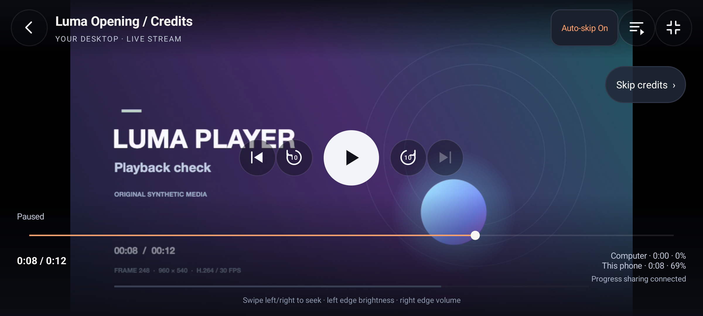
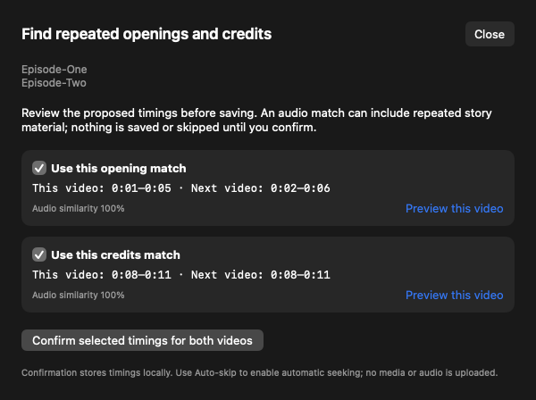
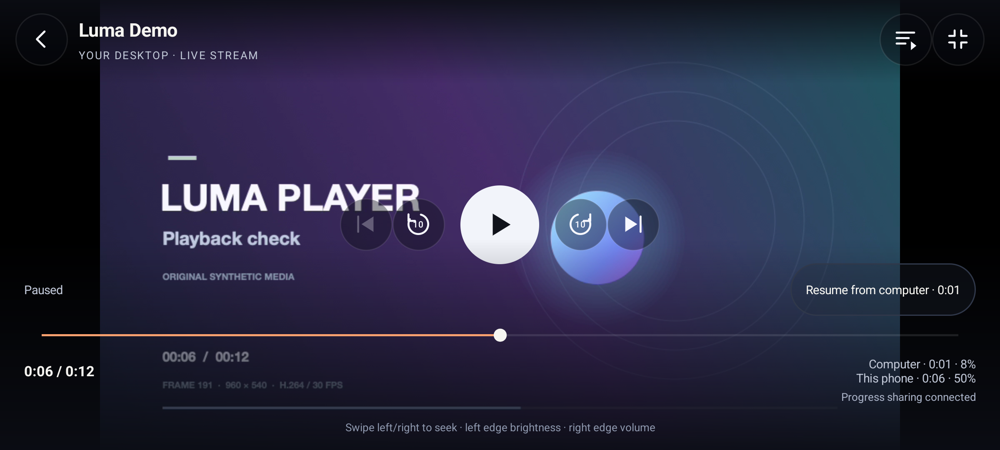
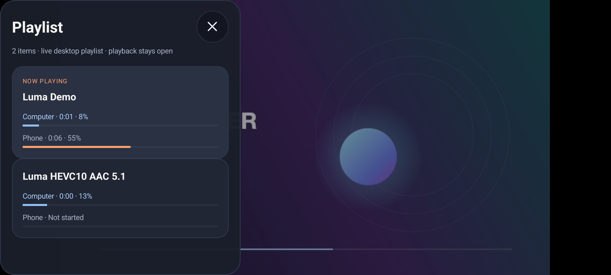

# Luma Player

**A free native media player by sdas for Mac and Windows, with an Android Wi-Fi streaming companion.** Desktop playback uses bundled libVLC 3. The owner tested the public 0.7.0 preview and reported that it works as expected.

**Review source: desktop 0.9.0 / Android 0.3.0-preview** · macOS 14+ Apple Silicon · Windows 11 x64 · Android 8+ ARM64

**Public downloads remain desktop 0.7.0 / Android 0.1.0-preview.**

[Downloads](https://github.com/PopoD-alt/luma-player/releases/tag/v0.7.0-preview.1) · [Installation guide](INSTALL.md) · [Windows guide](Windows/README.md) · [Android guide](Android/README.md) · [Release notes](RELEASE_NOTES.md) · [Roadmap](ROADMAP.md)

## Auto-skip preview

The `feature/auto-skip` branch adds **desktop 0.9.0 / Android 0.3.0-preview** for review. `main` still contains the approved 0.8.0 interface update; public downloads remain 0.7.0 / Android 0.1.0. No release or update feed is changed by this feature branch.

- **Auto-skip starts off.** Enable it in the video's Auto-skip menu on Mac, the checkbox on Windows, or the Auto-skip settings button on Android.
- Recognised opening/intro and ending/credits chapters provide exact skip boundaries. A separate post-credit chapter remains playable. A **Skip intro / Skip credits** button also lets you jump manually.
- Without useful chapter names, mark the opening or credits start and end while watching. Saved desktop timings appear in the shared Android playlist; Android can also save a phone-only override.
- On Mac or Windows, choose **Analyze audio with next video** / **Analyze openings / credits with next queue item** to compare two episodes. Review the proposed times and confirm before saving. Mac can save selected matches for both displayed videos; Windows saves confirmed ranges for the current video.



Audio analysis stays on the desktop and uses the existing playback engine. It compares at most the first and last three minutes of each file, can take about **12 minutes** for long episodes, and supports cancellation. Pause before a long comparison if you want to prevent automatic queue advance from cancelling it. Production matching requires a repeated passage of at least 15 seconds. It finds repeated audio, which can also be a story scene. Suggestions are not saved, enabled or skipped automatically. This is original audio matching, without a trained AI model or cloud service; unrelated episodes, different theme edits and videos without repeated audio may yield no useful match.



The audio review image uses short authored test clips; normal analysis uses the longer production limits above.

Auto-skip runs only during seekable playback. Pausing does not trigger a skip, and deliberately seeking into a skipped section lets you replay it. Generic numbered chapters are not guessed as credits. Chapter boundaries can preserve a separately marked post-credit scene; an unlabelled scene inside a chapter named Credits cannot be identified by that label alone.

See the [Android auto-skip guide](Android/README.md#auto-skip-preview) and [Windows guide](Windows/README.md#auto-skip-preview). Review copies keep the existing signing/distribution limits; a new public package has not been published.

## Modern Android playback and device progress

The latest source on `main` includes **desktop 0.8.0 / Android 0.2.0-preview**. The owner approved the updated interface. The public downloads below remain **0.7.0 / Android 0.1.0** and do not include these changes. No stable update feed has been changed.

- Icon controls, previous/next, ten-second jumps and a seek bar in Android fullscreen; tap the picture to show/hide controls.
- Swipe horizontally across the video to seek. Slide vertically on the **right** for player volume or on the **left** for this window's brightness. The level indicator appears during the gesture, then disappears.
- Open the **playlist icon** for a left drawer over the playing video. Choosing another item starts it in the same playback screen.
- Separate **Computer** and **Phone** times, percentages and progress bars on both platforms. Choose **Resume from computer** on Android or **Resume from phone** on desktop to move playback explicitly. Incoming progress never seeks another running player.





Build/update both desktop and Android to the new versions for two-way progress reporting. The phone sends a checkpoint roughly every five seconds while playing and after pause/seek/leave; the desktop stores it locally. Multiple paired phones share the single **Phone** position for each video, rather than having separate profiles. With an older host, streaming still works and phone progress sharing is unavailable. See the [Android guide](Android/README.md#modern-player-review) for gestures and progress details.

The auto-skip feature above adds labelled chapters, saved ranges and confirmed repeated-audio suggestions. General AI scene/credit recognition remains future work.

## Download and install

- **Mac:** [Download the Apple Silicon DMG](https://github.com/PopoD-alt/luma-player/releases/download/v0.7.0-preview.1/Luma-0.7.0-macOS-arm64-unnotarized-preview.dmg). Open it, drag **Luma Player.app** into **Applications**, eject the image, then open Luma from Applications. This preview is ad-hoc signed and is not Apple-notarized; see [first-launch instructions](INSTALL.md#mac).
- **Windows:** [Download the x64 ZIP](https://github.com/PopoD-alt/luma-player/releases/download/v0.7.0-preview.1/Luma-0.7.0-Windows-x64-preview.zip). Extract the whole ZIP and open **Luma Player.exe** inside **Luma-Player-Windows-x64**. Keep that entire folder together. The .NET runtime and reviewed playback libraries are included; no separate VLC or .NET installation is needed. This is an unsigned portable app, without a setup wizard or uninstaller.
- **Android:** [Download the ARM64 APK](https://github.com/PopoD-alt/luma-player/releases/download/v0.7.0-preview.1/Luma-0.7.0-Android-arm64-preview.apk) and open it on the phone to install. Allow installation from the app used to open the APK when Android requests it. This is the debug-signed **0.1.0-preview companion**, included with the desktop 0.7.0 preview; it streams from a desktop and has no local-file picker or Play Store release. [Matching Android source and license companion](https://github.com/PopoD-alt/luma-player/releases/download/v0.7.0-preview.1/Luma-0.7.0-Android-arm64-source-and-notices.zip).

Use these platform assets rather than GitHub's automatic **Source code** ZIP to install the app. Downloads are free. Corresponding library sources, notices and replacement information accompany the packages; retain them when redistributing a package. Intel Macs, Windows ARM, 32-bit Android and iOS are not included.

## Play on your computer

1. Open Luma, then choose **Open Media** or drag local video/audio files into the window. Mac also accepts **⌘O**; Windows accepts **Ctrl+O**.
2. Choose an item in the playlist. Use the playback controls to pause, seek, change volume or speed, and save bookmarks.
3. Select audio/subtitle tracks from the available menus, or add an external caption file.

**Mac:** **Space** plays/pauses, **←/→** seek ten seconds, and **⌃⌘F** or a video double-click enters fullscreen. **Escape** exits fullscreen. Spaces still work normally in text fields.

**Windows:** **Space** plays/pauses, **←/→** seek ten seconds, and **F11** enters/exits fullscreen. **Escape** exits fullscreen.

The playlist references your files; adding media does not copy it into a new library. Keep the original files in place. The desktop saves its queue, playback positions and bookmarks locally.

## Stream your desktop playlist to Android

1. Add videos to the playlist on your Mac or Windows PC.
2. **Mac:** click the Wi-Fi sharing icon and choose **Start sharing this playlist**. **Windows:** choose **Share playlist → Start sharing**. The sharing panel displays the desktop address and a six-digit pairing code.
3. Connect Android to the **same trusted Wi-Fi**. Open Luma and allow local-network access when requested.
4. Choose the nearby desktop, or enter the exact displayed `http://IP-address:port` if discovery is unavailable. Enter the six-digit code.
5. Tap a video. The public 0.7.0 companion provides **Play/Pause**, **±10 seconds**, the seek slider and volume. Choose **Full screen**; tap the video to show its controls and choose **Exit full screen** to leave. Choose **Playlist** to select another video. The latest 0.8.0 / 0.2.0 source adds the icon controls, gestures and overlay drawer described above.

The files stay on your computer. The phone buffers the stream in memory instead of saving a downloaded movie. Playback on the phone is independent of desktop playback. The 0.8.0 / 0.2.0 builds exchange saved progress and offer explicit resume actions; they do not keep two running players in lockstep. Keep the computer on, Luma open and sharing enabled. Active streams request prevention of idle system sleep; lid closure, forced sleep or shutting down the host still interrupts playback.

The list refreshes every five seconds while Android is foregrounded. Backgrounding the companion stops streaming. Removing a shared item cuts off its stream. To disconnect everyone, use **Stop sharing and disconnect** on Mac or **Stop and revoke** on Windows. Sharing is off at desktop launch. Pairing codes expire after ten minutes; generate a new code on Mac or stop/restart sharing on Windows. Existing paired access lasts until sharing stops; pair again after restarting sharing.

Local HTTP is intended for a home network you trust. No cloud account, router port forwarding or uploading of your media is needed.

## If something does not work

- **Desktop not listed:** check both devices are on the same non-guest Wi-Fi. Enter the address shown by the desktop manually. `localhost` and `127.0.0.1` refer to the phone when entered on Android.
- **Cannot connect:** allow Luma through the desktop's private-network firewall. Guest/client isolation, VPNs and blocked multicast can prevent discovery or streaming. Luma does not fall back to cellular; reconnect the phone to Wi-Fi and retry.
- **Code expired or sharing restarted:** generate a fresh code, reconnect and pair again.
- **First Android playback takes longer:** wait for **Preparing playback for first use…** while native fonts are prepared. Keep Luma in the foreground.
- **Playback stops:** check that the computer is awake, sharing is still on, and the original file is present. Reconnect after changing Wi-Fi. If a file fails, include codec/container details in a [bug report](https://github.com/PopoD-alt/luma-player/issues).
- **Windows cannot find files/libraries:** extract the complete ZIP; do not move the EXE out of its folder or run it directly inside the ZIP.

## Support and preview limits

Native desktop checks cover H.264, HEVC Main10 MP4/MKV, AAC 5.1, captions, seeking and fullscreen. Android ARM64 checks cover streaming from both desktop server implementations, genuine native clock/seek behavior, surface recovery, independent re-signing and ten video switches. The owner has additionally reported successful testing; the exact device/format matrix was not supplied.

Support comes from selected libVLC modules. Every VLC format/profile, DRM, interactive disc menus, hardware decoder, surround route and A/V synchronization is not universally verified. Windows' downloadable EXE is cross-built on Mac; matching application source and the approved app-local runtime passed [native Windows CI](https://github.com/PopoD-alt/luma-player/actions/runs/43765447494).

There is an unresolved **x64 Android emulator test limitation**: [current CI](https://github.com/PopoD-alt/luma-player/actions/runs/43773929495) loses Wi-Fi after initially passing its Wi-Fi precondition. Luma correctly refuses the stream before an upstream connection. That run remains failed and is not presented as HEVC/stress success. ARM64 local checks pass; device coverage is documented in the [Android guide](Android/README.md). Owner feedback does not erase this CI result.

Older [Mac](CodecSupport.json) and [Windows](Windows/CodecSupport.json) original-codec catalogs are historical experiments, not the active backend's coverage or a current pending-codec count. Mac 0.6.1 and Windows build 3 downloads are older engines and lack this rebuild's Android sharing.

## Updates

For this preview, quit Luma and replace it with the newer platform download. Replace the complete Windows folder; install a newer Android APK signed with the same key. Preserve your original media files. Desktop library data lives outside the app bundle.

A Git push does not update installed apps. The existing signed Mac stable feed still points to 0.6.1; Windows has no configured public feed and Android automatic updates are not configured. This prerelease does not change those feeds. See [RELEASING.md](RELEASING.md).

## Build from source

```sh
git clone https://github.com/PopoD-alt/luma-player.git
cd luma-player
```

For Mac, use Apple Silicon, macOS 14+ and Swift command-line tools. Build/stage the pinned custom runtime using [ThirdParty/libvlc/REBUILD.md](ThirdParty/libvlc/REBUILD.md), then run `python3 Scripts/prepare-libvlc.py status` and `bash build.sh`. The output is `build/Luma Player.app`. An installed VLC 3 can be used for personal development when no bundled runtime exists; it is not the public package route.

For Windows use PowerShell 7 and the pinned .NET SDK; follow [Windows/README.md](Windows/README.md) for the approved bundled-runtime build. For Android use JDK 17 and the Android SDK; follow [Android/README.md](Android/README.md) to select the approved ARM64 component. Stock runtime dependencies remain development-only. Native binaries/toolchains and large corresponding-source bundles are not committed directly to Git.

Useful Mac checks include `bash test-vlc-bundle.sh`, `bash test-sharing.sh`, `bash test-fullscreen.sh` and `python3 Scripts/prepare-libvlc-tests.py`. The [cross-platform workflow](https://github.com/PopoD-alt/luma-player/actions/workflows/cross-platform-review.yml) publishes test evidence rather than application downloads.

## Ownership and licenses

Luma's original code belongs to **sdas** under the proprietary [LICENSE](LICENSE). Free downloads and visible source do not grant unrestricted reuse rights. libVLC, FFmpeg and other components retain their own licenses and modification/relinking rights; see [THIRD_PARTY_NOTICES.md](THIRD_PARTY_NOTICES.md) and each package's source/notices. Technical component checks and owner approval are not legal/patent clearance.
